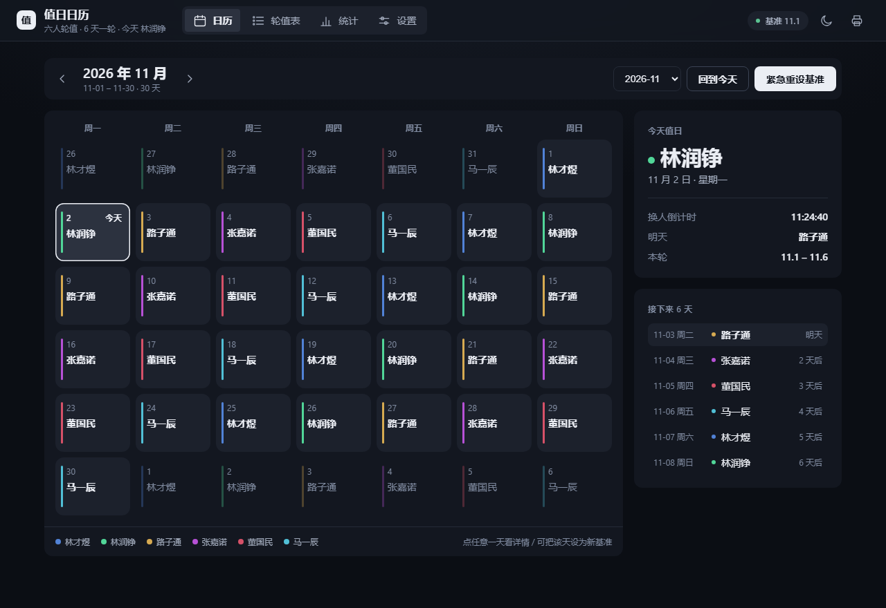

# 值日日历

六个人，6 天一轮，纯静态页面（无后端、无构建），部署到 GitHub Pages 就能用。
界面按 *Refactoring UI* 的规则重做过一遍：一套受限的设计令牌、三档文字色、两档字重、六档字号、四档圆角，
主操作是墨色实心按钮，六个人的身份色只做竖条和圆点（名字始终是墨色），深色界面用底色明度差表达层级。



## 轮值规则

```
11.1 林才煜 → 11.2 林润铮 → 11.3 路子通 → 11.4 张嘉诺 → 11.5 董国民 → 11.6 马一辰
11.7 又回到 林才煜 …（每人 1 天，循环不回退）
```

算法只有一句：`第 n 人 = (基准人序号 + (某天 − 基准日)) mod 6`。
所以日期往前也能算，日历翻到 10 月、12 月都对得上。

## 基准日：仓库根目录的 base_date.txt

文件就一行，写「哪天由谁开始」：

| 文件内容 | 含义 |
| --- | --- |
| `26.11.1` | 2026-11-01 由名单第 1 位（林才煜）值日，其后按名单顺序 |
| `26.11.1 张嘉诺` | 2026-11-01 由张嘉诺值日，其后董国民、马一辰…… |

写法很宽容：`26.11.1`、`2026.11.1`、`2026-11-01`、`26/11/1` 都认；
`#` 开头的行当注释跳过；文件名除 `base_date.txt` 之外也试 `basedate.txt` / `base-date.txt`。

**优先级**：URL 参数（`?base=26.11.15&who=张嘉诺`）> 本机临时基准 > `base_date.txt` > 内置默认 `26.11.1`。

## 放假 / 临时重设基准

放假打乱了节奏，又来不及改仓库文件时：

1. 打开页面，点右上角或日历工具条上的 **紧急重设基准**。
2. 选一个日期；「这天起由谁值日」**默认会自动跟随原轮值**（这天本来是谁就还是谁），
   顺延的话只改日期就行；真要换人再手动选。
3. 两个出口：
   - **仅本机生效** → 立刻重排日历，先自己/班里看；
   - **生效并下载 txt** → 同时得到新的 `base_date.txt`。
4. 把下载的 `base_date.txt` 覆盖到仓库根目录，提交并推送（设置页有「复制 git 推送命令」）。
5. 别人刷新页面就跟上了。

搞错了就点设置里的「撤销本机临时基准」，回到 `base_date.txt` 的值；或者再重设一次。
日历里点某一天 → 抽屉里也有「设为基准日」，等于把那天当成新的起点（轮值不变，只是重新锚定）。

## 本地预览

浏览器不允许 `file://` 页面读同目录的 `.txt`，直接双击 `index.html` 会退回内置默认值。
想让它读文件，起个本地服务：

```bash
cd dlj
python -m http.server 8787
# 打开 http://127.0.0.1:8787/
```

## 部署

推到 GitHub，仓库 Settings → Pages → 选分支根目录即可（纯静态，无需构建）。
`base_date.txt` 放在仓库根目录，和 `index.html` 同级。

仓库里另有 `.github/workflows/pages.yml`（Actions 构建）；把 Pages 的 Source 切成 **GitHub Actions**
就会走那条流水线，两种方式页面内容一致。

## 目录

```
dlj/
├── index.html          页面骨架（日历 / 轮值表 / 统计 / 设置）
├── base_date.txt       基准日（一行：26.11.1）
├── README.md
├── preview.png
├── .github/workflows/pages.yml   Actions 构建并部署 Pages
└── assets/
    ├── app.js          轮值计算 + 渲染 + 紧急重设
    └── style.css       设计令牌 + 组件样式
```

## 想改名单 / 顺序

编辑 `assets/app.js` 顶部的 `PEOPLE`：

```js
const PEOPLE = [
  { name: '林才煜', h: 218 },   // h 只是身份色色相
  { name: '林润铮', h: 152 },
  ...
];
```

数组顺序就是轮值顺序，长度就是周期（现在是 6 人 → 6 天一轮）。
改完保存，刷新页面即可；`11.1 → 林才煜` 这条规律由 `base_date.txt` 的基准日 + 顺序共同决定。

## 界面规范（设计系统）

所有取值都来自下面这套令牌，`assets/style.css` 顶部可查：

| 系统 | 取值 |
| --- | --- |
| 灰阶 | 冷调 `hsl(220 …)`，10 级（50 → 950），两端提高饱和度 |
| 文字色 | 只有三档：`text` / `text-secondary` / `text-muted` |
| 字重 | 只有 `400` 和 `600` |
| 字号 | `12 / 14 / 16 / 20 / 24 / 30` |
| 间距 | `4 / 8 / 12 / 16 / 24 / 32 / 48` |
| 圆角 | `4 / 8 / 12 / 999` |
| 阴影 | 两级：`shadow-1`（控件）/ `shadow-2`（浮层） |
| 层级 | `sticky 40 / overlay 60 / modal 70 / toast 90` |
| 身份色 | 六个人各一个色相，仅用于 3px 竖条与圆点；名字始终是墨色 |

几条刻意为之的决定：

- **主操作只有一个**，用墨色实心（`--action-bg`），不用品牌渐变；次要操作描边，其余是文字链。
- **深色界面靠底色的明度差表达层级**（bg → surface → raised → active），阴影只用于浮层。
- **颜色从不单独承载信息**：今天有描边 + 「今天」字样，我值日有加粗竖条 + 「我」字，
  身份色旁边永远有名字。
- **文字对比度全部实测过**：暗色 4.63:1 起（`text-muted` 在 raised 底上），亮色 5.01:1 起，
  正文与操作按钮都在 11:1 以上。
- 视图切换不做淡入；`prefers-reduced-motion` 下所有过渡降到近 0。
- 键盘可达：`:focus-visible` 有 2px 描边 + 2px 偏移；手机端按钮命中区 ≥ 44px。

## 功能一览

- **日历**：月历（周一起始）、今天描边 + 「今天」、非本月降一档、每人一条身份色竖条；工具条翻月 / 跳月 / 回到今天；`←` `→` 翻月，`t` 回到今天。
- **今日值日**：谁值日、几点换人倒计时、明天是谁、本轮起止。
- **接下来 6 天**：接棒顺序；标记「我」之后我的那行会加粗并显示「我」。
- **轮值表**：从今天起 30 天连续排班。
- **统计**：本月 / 下月各人天数、每人下一次值日与剩余天数。
- **设置**：当前基准与来源、`base_date.txt` 文本 / 复制 / 下载 / 重新读取、紧急重设、撤销本机基准、标记我、基准前后一览。
- **状态条**：读不到 `base_date.txt` 或正在用本机临时基准时，日历顶部会明确说明，而不是悄悄算错。
- 深浅色切换、打印（只打当前月）、手机端底部导航 + 紧凑月历 + 底部弹出表单。

